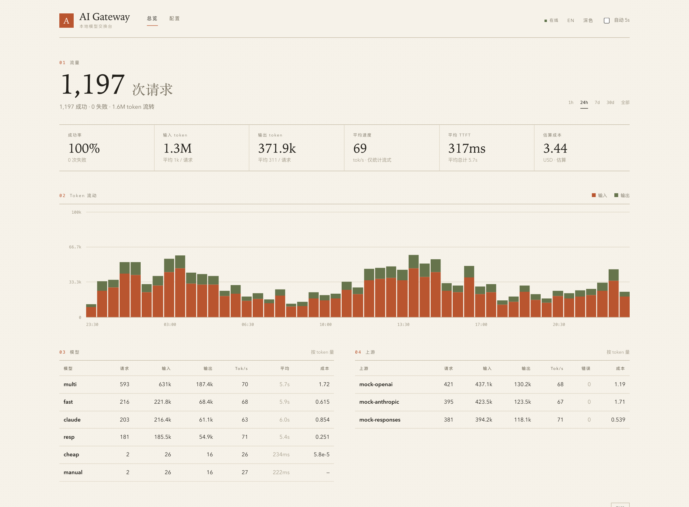
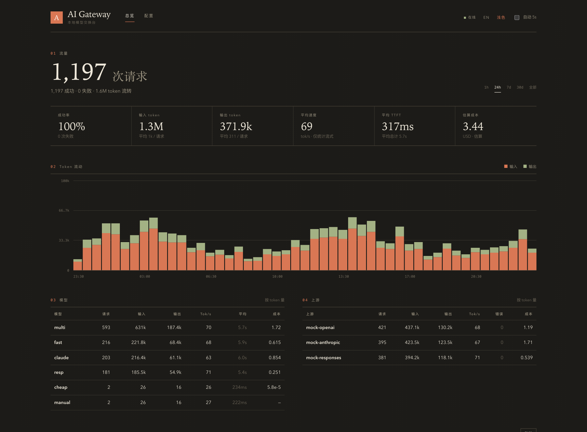
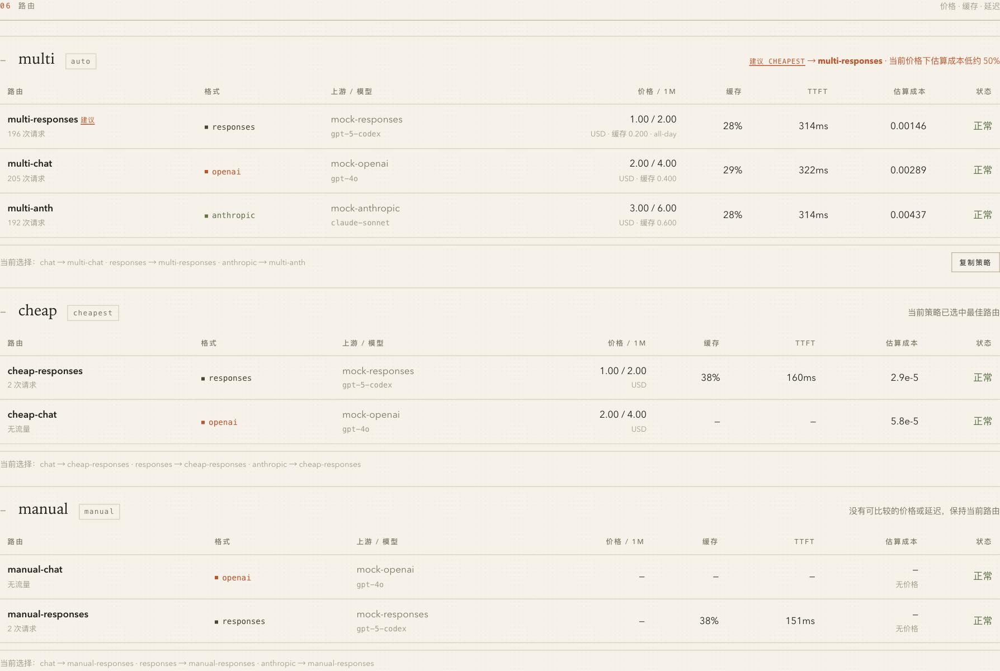

<div align="center">

# AI Gateway

### One local endpoint. Multiple AI protocols and providers.

A Rust gateway for **OpenAI Chat Completions, OpenAI Responses, and Anthropic Messages**, with configurable routing, streaming translation, and a local usage dashboard.

[简体中文](README.md) · **English** · [Detailed Chinese guide](docs/guide.zh-CN.md)

[](https://github.com/Ariakage/ai-gateway/actions/workflows/ci.yml)
[](https://github.com/Ariakage/ai-gateway/releases)
[](LICENSE)
[](https://github.com/Ariakage/ai-gateway/stargazers)

**Single binary · No Node.js runtime · SQLite metrics · English / Chinese UI · Light / dark themes**



<sub>Real application screenshots with synthetic local traffic. Displayed latency and prices are not provider benchmarks.</sub>

</div>

## What it does

- **Protocol translation:** bridge Chat, Responses, and Messages for text, image inputs, function calls, refusal text, and reasoning text.
- **Streaming:** translate SSE text and argument deltas, map completion states, send heartbeats, and enforce timeout / size budgets.
- **Routing:** choose `auto`, `priority`, weighted `round_robin`, `cheapest`, `fastest`, or `manual`; override a route per request.
- **Usage and pricing:** track prompt / output / cache tokens, estimated cost, TTFT, and tokens per second; keep different currencies separate.
- **Conversation continuation:** forward native Responses IDs on the same route or replay bounded local history across routes.
- **Embedded dashboard:** inspect metrics, edit / validate / hot-apply TOML, and discover upstream model catalogues without a frontend build.
- **Local-first defaults:** loopback binding, optional inference and admin keys, Host / Origin validation, and no conversation-body persistence in SQLite by default.

This is a personal or small self-hosted gateway, not a billing platform, account manager, or complete replacement for every provider-specific API.

## Quick start

Install a stable Rust toolchain, then clone:

```bash
git clone https://github.com/Ariakage/ai-gateway.git
cd ai-gateway
```

Create `config.toml`:

```toml
[server]
host = "127.0.0.1"
port = 8787
database = "gateway.db"

[[providers]]
id = "openai"
format = "openai"
base_url = "https://api.openai.com/v1"
api_key = "${OPENAI_API_KEY}"
models = ["gpt-4o-mini"]

[[models]]
name = "fast"
provider = "openai"
upstream = "gpt-4o-mini"
```

Use a model your provider actually supports, and start the gateway:

```bash
export OPENAI_API_KEY="your-provider-key"
cargo run --release -- --config config.toml
```

Open **http://127.0.0.1:8787**, then try:

```bash
curl http://127.0.0.1:8787/v1/chat/completions \
  -H 'Content-Type: application/json' \
  -d '{"model":"fast","messages":[{"role":"user","content":"Hello"}]}'
```

See [`config.example.toml`](config.example.toml) for multiple providers, price cards, and model aliases. If you copy the full example, remove unused providers or supply all referenced environment variables.

### Try it without provider credentials

Run each command in a separate terminal:

```bash
python3 dev/mock_upstream.py 19100
cargo run -- --config dev/test-config.toml
python3 dev/smoke_test.py
```

The demo dashboard is at **http://127.0.0.1:18787**. These requests only reach the local mock server.

## Client endpoints

| API | SDK base URL | Endpoint |
| --- | --- | --- |
| OpenAI Chat | `http://127.0.0.1:8787/v1` | `/v1/chat/completions` |
| OpenAI Responses | `http://127.0.0.1:8787/v1` | `/v1/responses` |
| Anthropic Messages | `http://127.0.0.1:8787` | `/v1/messages` |
| OpenAI Embeddings | `http://127.0.0.1:8787/v1` | `/v1/embeddings`; OpenAI-format routes only |

If an SDK requires a key, use `local` only when inference authentication is disabled. Otherwise use one of `server.api_keys`.

```python
from openai import OpenAI

client = OpenAI(base_url="http://127.0.0.1:8787/v1", api_key="local")
print(client.responses.create(model="fast", input="Hello").output_text)
```

```python
from anthropic import Anthropic

client = Anthropic(base_url="http://127.0.0.1:8787", api_key="local")
with client.messages.stream(
    model="fast", max_tokens=1024,
    messages=[{"role": "user", "content": "Hello"}],
) as stream:
    print(stream.get_final_text())
```

## Routing

| Strategy | Selection |
| --- | --- |
| `auto` | Prefer the incoming protocol, then effective cost and priority |
| `priority` | Configured priority among healthy routes |
| `round_robin` | Weighted rotation among healthy routes |
| `cheapest` | Current same-currency price cards and recent cache ratio |
| `fastest` | Recent TTFT EWMA, with initial probes and failure backoff |
| `manual` | A fixed route, regardless of price or health |

Use `x-gateway-route` to force a route. Response headers identify the selected provider, route, format, and upstream model. Health affects subsequent selections; it does **not** mean a failed request is automatically retried.

Cost is an estimate, not a provider invoice. Mixed currencies are not converted or added together; `cheapest` rejects mixed comparable currencies.

## Screenshots

<details>
<summary><strong>Dark dashboard</strong></summary>



</details>

<details>
<summary><strong>Routing, price cards, and recommendations</strong></summary>



</details>

Screenshots use temporary configuration and synthetic traffic, never private provider settings or real usage records.

## Security and limitations

> [!IMPORTANT]
> For any public deployment, configure both `server.api_keys` and `server.admin_token`, allow the intended Host, and use a TLS reverse proxy. Admin access can expose raw provider credentials.

- Some cross-protocol fields are intentionally dropped: multiple candidates, logprobs, vendor sampling settings, hosted tools, and cache-control directives are not universally portable.
- Use native Responses routes for hosted tools. JSON Schema translated into an Anthropic system prompt is **not** strict structured-output enforcement.
- Reasoning text can be translated; cryptographic thinking signatures cannot be preserved across protocols.
- Local conversation history is bounded, memory-only, and expires. Defaults: 128 entries, 16 MiB, one-hour TTL. Full retrieve / cancel / background lifecycle support is not implemented.
- Requests still go to your configured upstream. SQLite stores metadata rather than conversation bodies by default, but enabling detailed error storage may persist text echoed by an upstream.
- Token counting is heuristic. Usage falls back to estimates when provider counters are unavailable or unusable.

[Security policy](SECURITY.md) · [Complete configuration and protocol guide](docs/guide.zh-CN.md)

## Development

```bash
cargo test
cargo build --locked
cargo clippy --all-targets -- -D warnings
```

With the mock upstream and test gateway running:

```bash
python3 dev/smoke_test.py
python3 -m pip install openai anthropic
python3 dev/sdk_test.py
```

Pre-release local verification passed **116 unit tests, 90 smoke checks, and 34 official SDK checks**. These use mock upstreams, not paid provider calls; subsequent results are shown by CI.

## Contributors and leaderboard

See [CONTRIBUTING.md](CONTRIBUTING.md) for the workflow and [GitHub's contributor leaderboard](https://github.com/Ariakage/ai-gateway/graphs/contributors) for actual contribution statistics.

[](https://github.com/Ariakage/ai-gateway/graphs/contributors)

## Star History

[](https://www.star-history.com/#Ariakage/ai-gateway&Date)

A new repository needs stars before a curve is available. Third-party badges and charts may lag behind GitHub.

---

[MIT](LICENSE) · [Changelog](CHANGELOG.md) · [Releases](https://github.com/Ariakage/ai-gateway/releases) · [Report an issue](https://github.com/Ariakage/ai-gateway/issues)
