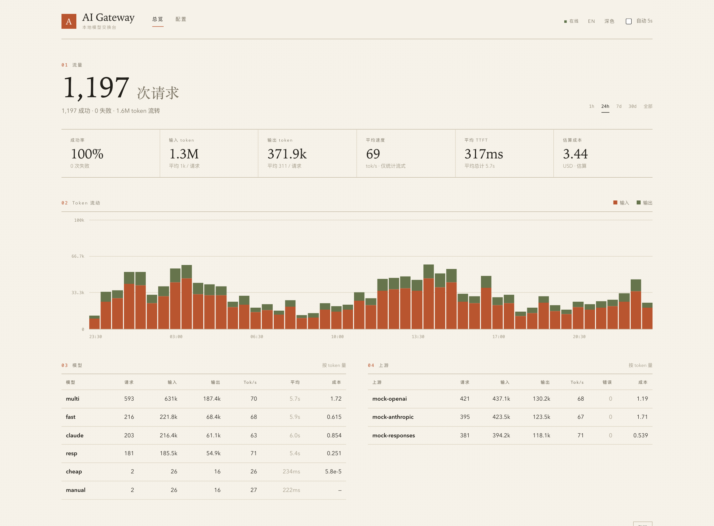
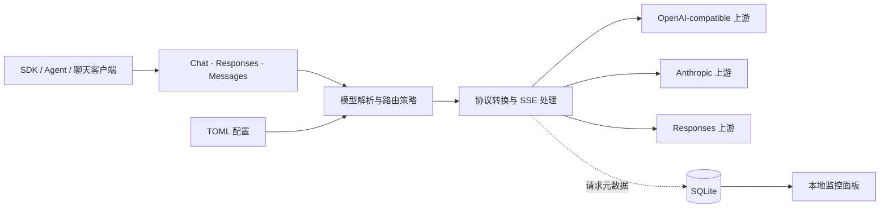
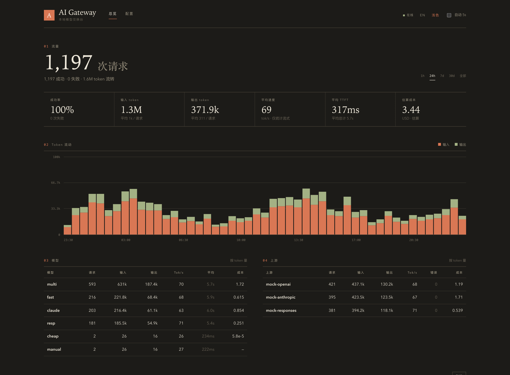
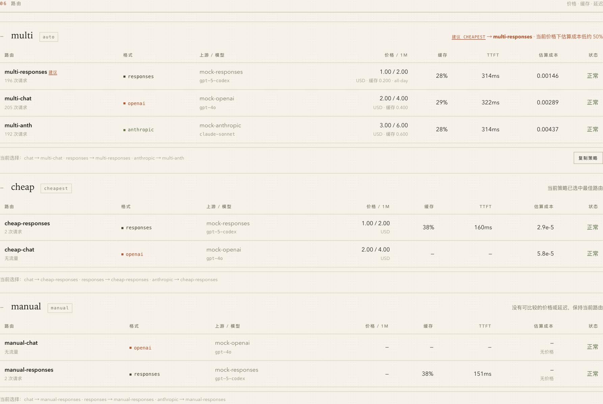

<div align="center">

# AI Gateway

### 一个本地入口，连接多种 AI 协议与上游。

用 Rust 编写的轻量 API 网关。统一 **OpenAI Chat Completions / Responses / Anthropic Messages**，把路由、流式转换和用量统计留在你自己的机器上。

[简体中文](README.md) · [English](README.en.md) · [使用手册](docs/guide.zh-CN.md) · [配置示例](config.example.toml)

[](https://github.com/Ariakage/ai-gateway/actions/workflows/ci.yml)
[](https://github.com/Ariakage/ai-gateway/releases)
[](Cargo.toml)
[](LICENSE)
[](https://github.com/Ariakage/ai-gateway/stargazers)
[](https://github.com/Ariakage/ai-gateway/forks)

**单个二进制 · 无需 Node.js · SQLite 统计 · 中英双语面板 · 明暗主题**



<sub>真实界面截图；所有图中数据来自本地模拟上游，仅用于演示，不代表真实模型性能或费用。</sub>

</div>

---

[为什么做这个](#为什么做这个) · [功能](#功能一览) · [快速开始](#快速开始) · [客户端](#客户端接入) · [路由](#路由与价格) · [截图](#界面预览) · [开发](#开发与测试) · [Star History](#star-history)

## 为什么做这个

不同客户端要不同的 API 格式，不同模型又分散在不同上游。更换模型时，不应该总要改客户端配置；查看消耗，也不应该总在多个供应商后台之间切换。

AI Gateway 在本地提供一个统一入口：客户端使用熟悉的协议，上游按你的配置选择，面板记录实际请求走了哪里、用了多少 token、花了多久。

适合个人开发环境、小型自托管部署，以及需要在多个兼容上游之间切换的 Agent / SDK 工作流。**它不是供应商账号系统、支付平台，也不是所有专有 API 能力的完整替代品。**

## 功能一览

| 能力 | 项目做什么 |
| --- | --- |
| **三种协议互通** | Chat、Responses、Messages 入站与上游格式之间转换；支持文本、图片输入、普通函数工具调用、拒答和 reasoning 文本 |
| **流式响应** | SSE 文本与工具参数增量转换，结束状态映射、心跳、响应头与空闲超时、事件大小限制 |
| **多上游路由** | `auto`、`priority`、`round_robin`、`cheapest`、`fastest`、`manual` 六种策略；支持单次请求强制选路 |
| **价格与缓存** | 分时价格卡、缓存读写用量、同币种成本比较；不同币种分别汇总，不隐式换汇 |
| **会话续接** | `previous_response_id`：同原生 Responses 路由使用上游状态，跨路由使用有界内存历史展开 |
| **本地可观测性** | SQLite 保存请求元数据、用量、状态、TTFT、tok/s 和成本；缺失用量时估算并标记 |
| **内置管理面板** | 中英切换、明暗主题、在线 TOML 编辑、校验、备份、热应用、模型目录发现与同步 |
| **安全默认值** | 默认回环监听、可选客户端 key 与管理 token、Host / Origin 校验；默认不保存错误正文 |

### 工作方式



运行时由 **Axum + Tokio** 提供 HTTP 服务，**reqwest / rustls** 连接上游，**rusqlite** 保存统计。前端是随二进制嵌入的 HTML，不需要额外启动前端服务。

## 快速开始

需要 Rust 稳定版工具链。首次编译需要下载 Cargo 依赖。

```bash
git clone https://github.com/Ariakage/ai-gateway.git
cd ai-gateway
```

创建 `config.toml`。下面是只连接一个 OpenAI-compatible 上游的最小示例：

```toml
[server]
host = "127.0.0.1"
port = 8787
database = "gateway.db"

[[providers]]
id = "openai"
format = "openai"
base_url = "https://api.openai.com/v1"
api_key = "${OPENAI_API_KEY}"
models = ["gpt-4o-mini"]

[[models]]
name = "fast"
provider = "openai"
upstream = "gpt-4o-mini"
```

将模型名替换为你的上游实际支持的模型，然后启动：

```bash
export OPENAI_API_KEY="你的上游密钥"
cargo run --release -- --config config.toml
```

打开 **[http://127.0.0.1:8787](http://127.0.0.1:8787)** 查看面板，发送第一条请求：

```bash
curl http://127.0.0.1:8787/v1/chat/completions \
  -H 'Content-Type: application/json' \
  -d '{"model":"fast","messages":[{"role":"user","content":"你好"}]}'
```

> 默认没有客户端鉴权，仅适用于可信本地环境。完整多供应商示例见 [`config.example.toml`](config.example.toml)；复制它后需删除不用的 provider，或为其配置所需环境变量。

### 不使用真实密钥体验

三个终端分别运行以下命令。请求只会访问本地模拟上游，不产生供应商费用。

```bash
# 终端 1：模拟三种上游协议
python3 dev/mock_upstream.py 19100

# 终端 2：测试网关，面板在 http://127.0.0.1:18787
cargo run -- --config dev/test-config.toml

# 终端 3：产生测试流量并验证功能
python3 dev/smoke_test.py
```

## 客户端接入

| 客户端协议 | Base URL | 请求入口 |
| --- | --- | --- |
| OpenAI Chat | `http://127.0.0.1:8787/v1` | `/v1/chat/completions` |
| OpenAI Responses | `http://127.0.0.1:8787/v1` | `/v1/responses` |
| Anthropic Messages | `http://127.0.0.1:8787` | `/v1/messages` |
| OpenAI Embeddings | `http://127.0.0.1:8787/v1` | `/v1/embeddings`，仅 `openai` 格式上游 |

SDK 要求填写 API key 时，本地未开启鉴权可填 `local`；开启 `server.api_keys` 后必须使用其中的 key。客户端使用的是映射后的模型名，不必与供应商原名相同。

<details>
<summary><strong>Python · OpenAI Chat / Responses</strong></summary>

```python
from openai import OpenAI

client = OpenAI(base_url="http://127.0.0.1:8787/v1", api_key="local")

reply = client.responses.create(model="fast", input="解释一下 Rust 的所有权")
print(reply.output_text)

for chunk in client.chat.completions.create(
    model="fast",
    messages=[{"role": "user", "content": "用三句话介绍这个项目"}],
    stream=True,
):
    for choice in chunk.choices:
        print(choice.delta.content or "", end="", flush=True)
```

</details>

<details>
<summary><strong>Python · Anthropic Messages</strong></summary>

```python
from anthropic import Anthropic

client = Anthropic(base_url="http://127.0.0.1:8787", api_key="local")
with client.messages.stream(
    model="fast",
    max_tokens=1024,
    messages=[{"role": "user", "content": "你好"}],
) as stream:
    print(stream.get_final_text())
```

</details>

Claude Code、自定义 OpenAI Base URL 的聊天客户端及其他 Agent 的配置说明见[使用手册](docs/guide.zh-CN.md#客户端接入)。客户端支持范围取决于其使用的协议和专有功能，不代表全部客户端已做真实服务验证。

## 路由与价格

一个客户端模型名可以对应多条 `[[models.routes]]`，每条有独立 provider、上游格式、优先级、权重与价格卡。

| 策略 | 选择依据 |
| --- | --- |
| `auto` | 优先原生格式，再比较有效成本与优先级；可配置关闭原生优先 |
| `priority` | 优先级，避开冷却中的路由 |
| `round_robin` | 健康路由之间按权重轮询 |
| `cheapest` | 当前价格卡与缓存命中率折算的估算成本 |
| `fastest` | 近期首字延迟 EWMA；未采样路由有探测与退避机制 |
| `manual` | 固定指定路由，不自动按健康或价格切换 |

使用 `x-gateway-route` 可为一次请求选路；响应提供 `x-gateway-route`、`x-gateway-provider`、`x-gateway-format` 和 `x-gateway-upstream-model`。

**边界：**健康状态影响后续请求的选路，不代表一次失败请求会被自动重试。成本不是供应商账单；不同币种不会直接相加或换汇，`cheapest` 遇到混合可比币种会返回错误。

[查看多路由配置、分时价格与完整策略说明 →](docs/guide.zh-CN.md#多路由分时价格与转发策略)

## 界面预览

### 深色监控面板



### 路由、价格与切换建议



截图取自本项目真实运行界面，使用隔离的临时配置和模拟数据；不包含私有供应商信息、真实密钥或个人用量。截图中的价格和延迟仅作界面演示。

## 安全与兼容性边界

> [!IMPORTANT]
> 本项目默认面向可信本地环境。公网部署请同时配置 `server.api_keys`、`server.admin_token`、允许的 Host，并放在 TLS 反向代理之后。管理端能读取原始配置，应视为高权限接口。

- **不是所有协议字段都能无损转换。** `n > 1`、`logprobs`、部分采样参数和专有工具跨格式时不会完整保留。
- **托管工具优先用原生 Responses。** web search、file search、computer use 等不能当作普通 function tool 翻译。
- **结构化输出存在差异。** 转到 Anthropic 时 JSON Schema 作为提示词使用，不保证严格符合 schema。
- **Thinking 签名不能跨协议保真。** reasoning 文本可以转换，但不保证签名可用于原生 Anthropic 续接。
- **会话不是持久存储。** 本地 Responses 缓存默认 128 条 / 16 MiB / 1 小时，重启丢失；完整 retrieve / cancel / 后台任务生命周期未实现。
- **隐私不等于绕过上游。** 推理内容仍会发给你配置的供应商；SQLite 默认保存元数据而非对话正文。启用错误详情存储可能使供应商回显内容落库。
- **计数与成本有估算。** token 计数接口不是官方 tokenizer；上游未提供有效 usage 时会估算并标记。

[安全说明](SECURITY.md) · [完整兼容性说明](docs/guide.zh-CN.md#协议转换说明)

## 开发与测试

```bash
cargo test
cargo build --locked
cargo clippy --all-targets -- -D warnings
```

启动前述本地模拟上游和测试网关后，可继续运行：

```bash
python3 dev/smoke_test.py
python3 -m pip install openai anthropic
python3 dev/sdk_test.py
```

发布前本地验证：**116 项单元测试、90 项冒烟检查、34 项官方 SDK 检查通过**。这不是性能基准，也不是对真实供应商的兼容性担保；后续结果以 CI 和脚本输出为准。

```text
src/main.rs       HTTP 入口、鉴权、Host / Origin 防护
src/proxy.rs      请求转发、SSE 转换、用量采集
src/translate.rs  三种协议的请求与响应映射
src/router.rs     路由选择、健康状态、延迟与缓存 EWMA
src/config.rs     TOML、模型映射、价格卡与校验
src/store.rs      有界内存会话历史
src/stats.rs      SQLite 记录与聚合
src/admin.rs      配置、统计与模型同步接口
src/sanitize.rs   上游噪声标记清理
static/           内嵌监控面板
dev/              本地模拟上游与集成测试
```

## 参与项目

欢迎提交带最小复现的 Issue 或 PR，尤其是跨格式工具调用、SSE 事件与客户端兼容性案例。请先阅读 [贡献指南](CONTRIBUTING.md)，提交前移除密钥、对话正文和个人数据。

### 贡献者榜

[](https://github.com/Ariakage/ai-gateway/graphs/contributors)

[](https://github.com/Ariakage/ai-gateway/graphs/contributors)

点击查看 **GitHub 实时贡献者排行榜**，按实际提交统计；新仓库可能暂时只有维护者，第三方图片也可能需要等待缓存更新。

## Star History

[](https://www.star-history.com/#Ariakage/ai-gateway&Date)

新仓库需要积累 Star 后才有可展示的曲线。徽章、贡献者图片和历史图由第三方服务生成，可能存在延迟。

如果这个项目帮你减少了配置切换，欢迎点一个 **Star**，也欢迎分享你的兼容性反馈。

---

<div align="center">

[MIT License](LICENSE) · [Changelog](CHANGELOG.md) · [Releases](https://github.com/Ariakage/ai-gateway/releases) · [Issues](https://github.com/Ariakage/ai-gateway/issues)

</div>
